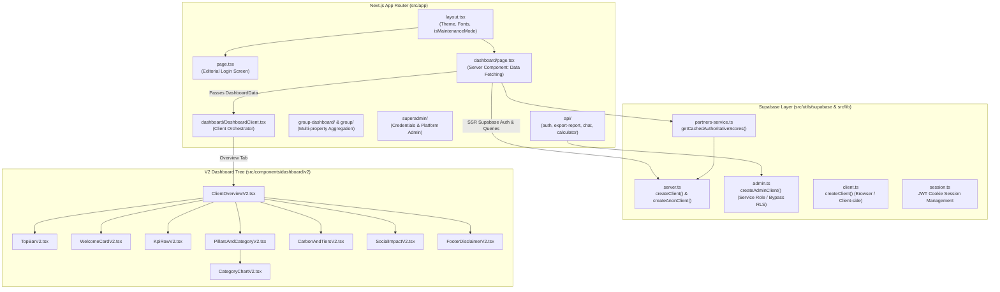

# Varna Systems Architectural Knowledge Graph

> **CRITICAL NOTICE**: This document represents the structural knowledge graph and dependency topology of the Varna application. All AI agents and developers must consult this document prior to making modifications.

---

## 1. Global Topology & Architecture Overview

The Varna platform is built on Next.js 16 (App Router), React 19, Tailwind CSS, and Supabase (PostgreSQL). It serves luxury hospitality clients with Scope 3 carbon accounting, supplier ESG scoring, order analysis, and group-level aggregations.

---

## 2. Node Breakdown & Layer Specifications

### A. Next.js App Router Structure (`src/app/`)

- **`src/app/layout.tsx`**:
  - Global root layout wrapping the entire application.
  - Hosts `ThemeProvider`, `@vercel/analytics`, and custom typography definitions (`--font-cormorant`, `--font-playfair`, `--font-inter`, `--font-caveat`, `--font-cedarville`).
  - Contains the `isMaintenanceMode` toggle flag for whole-application route interception during migrations.
- **`src/app/page.tsx`**:
  - Root landing and client authentication portal.
  - Implements the luxury editorial login experience (VARNA SVG wordmark, responsive image carousel, error handling).
- **`src/app/dashboard/`**:
  - `page.tsx`: Primary Server Component. Authenticates sessions via `getSession()`, reads client context (`searchParams.clientId`), executes parallel Supabase data queries, and passes hydrated `DashboardData` to `DashboardClient`.
  - `DashboardClient.tsx`: Client-side tab router and state manager handling 5 core tabs:
    1. **Overview**: Renders `ClientOverviewV2`
    2. **Suppliers / Partners**: Renders `ClientSuppliersV2`
    3. **Orders**: Renders `ClientOrdersV2`
    4. **Impact**: Renders `ClientImpactV2`
    5. **Calculator**: Renders `CalculatorView`
  - `layout.tsx`: Layout wrapper featuring maintenance intercept capability for dashboard routes.
  - Sub-routes: `calculator/`, `impact/`, `orders/`, `overview/`, `partners/`, `suppliers/`.
- **`src/app/group-dashboard/` & `src/app/group/`**:
  - Enterprise group dashboard for multi-property hospitality chains (e.g. Meridian Hospitality Group DEMO).
  - Handles portfolio-wide rollups, spend-at-risk analysis, and property-specific drilldowns via `src/app/group/properties/[hotelId]/page.tsx`.
- **`src/app/superadmin/`**:
  - Internal management interface for credentials, enterprise assessments, certificates, and partner scores.
- **`src/app/api/`**:
  - `/api/auth`: Login endpoint with dual-mode password verification (bcrypt + plaintext migration fallback) and HMAC-SHA256 JWT cookie issuance.
  - `/api/export-report`: PDF report generation via `@react-pdf/renderer`.
  - `/api/chat`: Gemini-powered conversational assistant widget.
  - `/api/calculator/seed`: Direct emission factor and product dataset seeding endpoint.

---

### B. V2 Component Hierarchy (`src/components/dashboard/v2/`)

The V2 dashboard suite delivers an editorial, luxury aesthetic using warm alabaster backgrounds (`#FAF8F5`), stone charcoal (`#1C1917`), and terracotta accents (`#8C4A27` / `#9A4A2E`).

- **`ClientOverviewV2.tsx`**:
  - Master container for the property overview dashboard.
  - Subscribes to `DateRangeContext` (`useDateRange`) to dynamically filter orders, spend, and carbon metrics without full-page reloads.
  - Coordinates child component tree:
    - **`TopBarV2.tsx`**: Property identity header, hotel switcher, PDF export trigger, and date-range picker.
    - **`WelcomeCardV2.tsx`**: Editorial welcome message, property type badge, and curated ESG impact quote.
    - **`KpiRowV2.tsx`**: Four primary KPI cards:
      1. *Total Spend (INR)*
      2. *Total Orders Delivered*
      3. *CO₂e Avoided (kg)*
      4. *Average Varna ESG Score (out of 100)*
    - **`PillarsAndCategoryV2.tsx`**:
      - Displays the 4 ESG & Craft pillar score bars: **Environmental (E)**, **Social (S)**, **Governance (G)**, and **Craft (C)**.
      - Embeds **`CategoryChartV2.tsx`** for interactive horizontal bar charts comparing spend and carbon footprint by category (`Bathroom Amenities`, `Packaging`, `Disposables`).
    - **`CarbonAndTiersV2.tsx`**:
      - Donut chart depicting supplier tiers (*Varna Leader*, *Advanced*, *Emerging*, *Foundational*).
      - Tangible equivalence metrics (Car km avoided, Trees equivalent).
    - **`SocialImpactV2.tsx`**:
      - Fair trade & social metrics: Gender parity %, artisan livelihoods supported, and living wage ratio compliance.
    - **`FooterDisclaimerV2.tsx`**:
      - Standards compliance footer (ISO 14064, GHG Protocol Scope 3, CSRD reporting alignment).

---

### C. Supabase Database Utility Layer

1. **Client Factory Structure**:
   - **`src/utils/supabase/server.ts`**:
     - `createClient()`: Server-side client using `@supabase/ssr` cookies for user-scoped, RLS-enforced queries.
     - `createAnonClient()`: Cookie-free instance used in cached functions (`unstable_cache`) to prevent serialization errors.
   - **`src/utils/supabase/admin.ts`**:
     - `createAdminClient()`: Service role client using `SUPABASE_SERVICE_ROLE_KEY`. Bypasses RLS for authentication, credentials management, and database migrations.
   - **`src/utils/supabase/client.ts`**:
     - Browser-side Supabase client for client-side events.
   - **`src/utils/supabase/middleware.ts`**:
     - Handles session token refreshes and route guards.

2. **Core PostgreSQL Database Tables**:

| Table Name | Primary Keys / Indexes | Role & Contents |
| :--- | :--- | :--- |
| `client_master` | `client_id` (TEXT) | Hotel client properties (`CLT-001` through `CLT-011`), contact details, parent group associations. |
| `client_summary` | `client_id` (TEXT) | Pre-aggregated totals: total spend, total units, CO₂e avoided, car-km avoided, pillar averages (E1–E6, S1–S4, G1–G3). |
| `client_credentials` | `client_id` (TEXT UNIQUE) | Authentication credentials (`password`, `is_superadmin`, `is_group`, `parent_group`). |
| `supplier_detail_by_client` | `client_id`, `enterprise_id` | Contracted supplier relationships per hotel with spend, units, and sub-criteria scores. |
| `category_spend_by_client` | `client_id`, `category_name` | Category-specific spend, order volume, and carbon avoidance. |
| `order_registry` | `order_id`, `line_number` | Line-item order ledger tracking SKU purchases, delivery statuses, unit costs, and carbon intensity. |
| `products` | `product_id` (TEXT) | Comprehensive catalog (147 products) with `baseline_co2e`, `alternative_co2e_per_unit`, and `savings_per_unit`. |
| `product_catalogue` | `sku_id` (TEXT) | Master inventory SKUs linked to sustainable suppliers. |
| `calculator_products` | `product_id` (TEXT) | Native Scope 3 calculator products mapping conventional vs. sustainable alternatives. |
| `calculator_emission_factors` | `factor_id` (TEXT) | 111 Recommended open-license emission factors (UK DEFRA/DESNZ, GreenCalculus). |

---

## 3. Best Practices for Modifying This Codebase

1. **Preserve Editorial Typography**: Headings and brand titles must use `font-serif` (`Cormorant Garamond` / `Playfair Display`), while UI controls and data tables must use clean sans-serif (`Jost` / `Inter`).
2. **Derived Calculation Reactivity**: In calculator and analytics views, never use asynchronous `useEffect` chains for math; derive metrics synchronously via `useMemo` from the primary array state.
3. **Dual Client Awareness**: When implementing Server Components, import `createClient` from `@/utils/supabase/server`. When building background jobs or migration scripts, use `createAdminClient` from `@/utils/supabase/admin`.
4. **Maintenance Mode Protocol**: To toggle the global maintenance screen, update `isMaintenanceMode` in `src/app/layout.tsx`.

